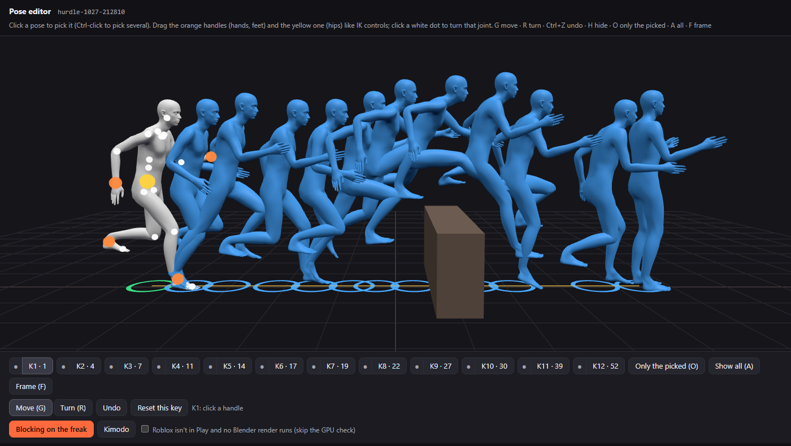
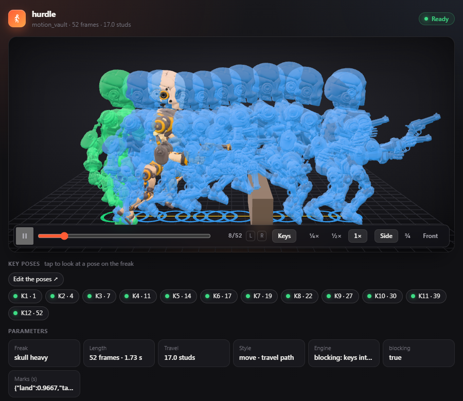
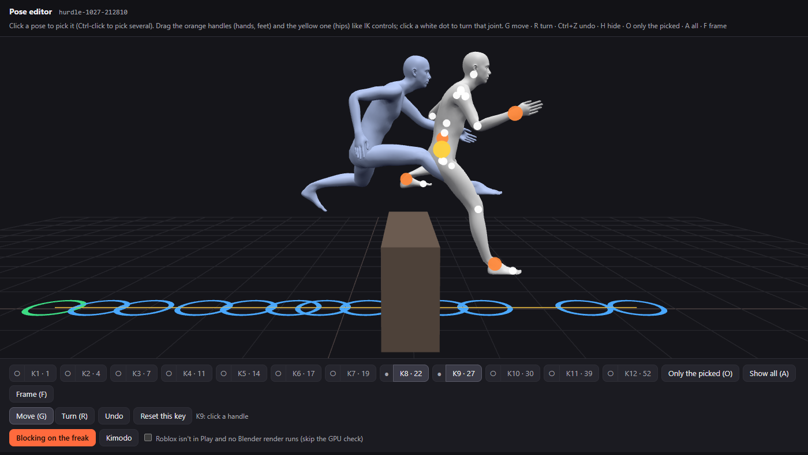
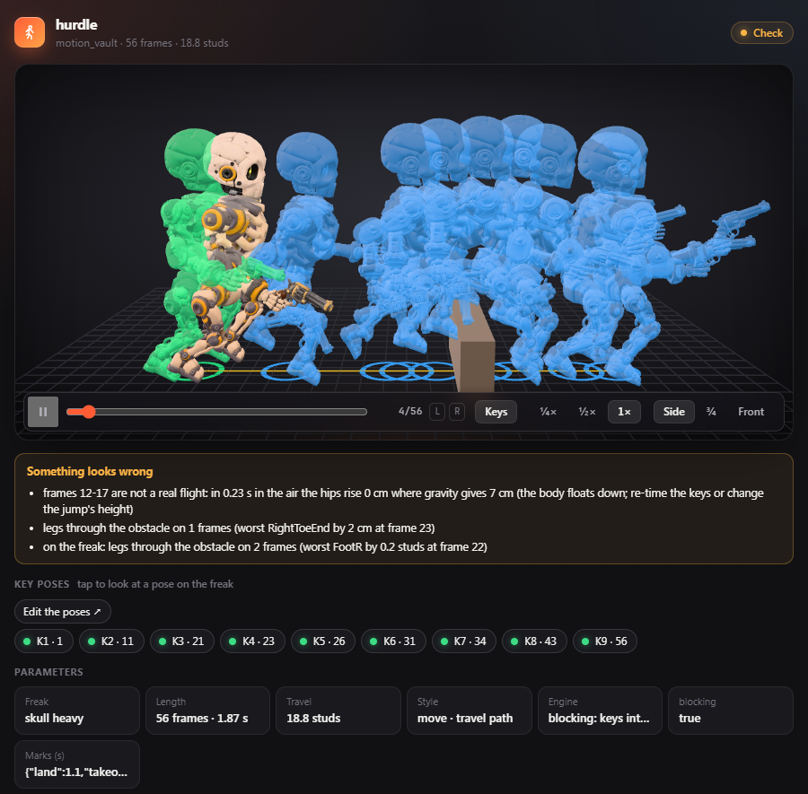
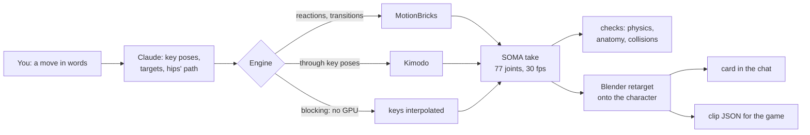

# MotionBricks Studio

**Offline character motion from key poses, driven from Claude Code.** You describe a move; Claude writes the key poses,
hand and foot targets and the hips' path; NVIDIA **MotionBricks** and **Kimodo** fill in the motion on your GPU; Blender
puts it on the game character; a card in the chat plays it and says what looks wrong; the clip goes out as the game's
animation JSON.

[](LICENSE)




Built for Build a Freak, a Roblox game, and its character SKULL: reactions, knock-backs, vaults, a limp,
transitions and idle drafts. It runs fully offline and **text-free**: no language model is ever downloaded for the motion
models; the Claude you talk to is the text layer.

## What it looks like

| The clip on the character, in the chat | Over the box, picked out in the editor |
|---|---|
|  |  |

When a pose breaks physics or anatomy, the card says so, and the tool text tells Claude to pass it on:



## How a clip is made



1. **A take on SOMA.** A Python worker generates the motion on NVIDIA's 77-joint SOMA skeleton:
   `python/mb_worker.py` runs MotionBricks' motion player on our poses, `python/kimodo_worker.py` runs Kimodo with
   full-body, end-effector and root-path constraints. Both share `python/soma.py` (posing, the pose library, checks, the
   BVH writer). `python/blocking.py` is the CPU preview: the key poses interpolated, no model, a few seconds.
2. **On the character.** `blender/retarget.py` retargets the take in Blender (leg solve, arm clearance, the character's
   own hinges and style) and writes the game's clip format: 15 joints, quaternions relative to rest, studs, foot
   contacts, marks and the root path.
3. **In the chat.** The tool result carries the character as a small GLB (45k triangles, 512 px WebP) and the clip's
   frames, so the card plays it with no server, in the desktop and the phone app. It is an
   [MCP App](https://github.com/modelcontextprotocol/ext-apps) built with three.js.

One Go binary holds it all: the MCP server over stdio, the local preview server, the card and the editor embedded.

## Tools

| Tool | Engine | What |
|---|---|---|
| `motion_hit_reaction` | MotionBricks, ~0.3 s | light, medium or knock-back from the front, back, left or right |
| `motion_transition` | MotionBricks, ~4 ms a step | from a pose or a clip's end through target poses (or another clip's frame) |
| `motion_from_keys` | Kimodo, ~3 s | full-body key poses, hand and foot targets, the hips' ground path |
| `motion_vault` | Kimodo | over an obstacle by height and speed: a running hurdle, or a one-hand vault for taller ones |
| `motion_locomotion` | Kimodo | along a path; a limp (`limp_right` / `limp_left`) or your own style pose |
| `motion_retarget` | Blender, ~10 s | the clip on the character again with another style preset or travel mode |
| `motion_export` | | the clip JSON for the game's clip exporter |
| `motion_show`, `motion_poses` | | a clip's card or the recent list; the pose library |

`motion_vault` and `motion_from_keys` take `blocking=true`: the key poses alone on the character, no GPU, to judge the
poses before a model runs through them. The plugin's `motion-studio` skill tells Claude how to write poses and when to use
which tool.

## The pose editor

Every clip made from key poses has an **Edit the poses** button on its card, opening
`http://127.0.0.1:5191/edit/<clip>`. The keys stand along the hips' path on the SOMA body, as in MotionBricks' own demo:

- drag the hands, feet and hips like IK controls (the feet stay planted while the body moves);
- turn any joint with the rings; undo, reset a key;
- hide keys, show only the picked ones (Ctrl-click to pick several), frame them; `#keys=8,9` in the link opens on those;
- **Blocking on the freak** or **Kimodo** runs the clip again through your poses and opens the new clip's card below.

The body is Kimodo's own SOMA skin, read from your Kimodo install and skinned in the page.

## Checks: the card says what looks wrong

Every take is checked on SOMA (`soma.checks`) and again on the character (`blender/retarget.py`):

- **Physics.** With both feet off the floor and no hand planted for *T* seconds, the hips must rise *g T²/8* over the
  line from take-off to landing: more and the body hovers, less and it floats down.
- **Anatomy.** A knee or elbow bent past 155°, backwards, or sideways off its hinge; a hip flexed past 145°, stretched
  back past 35°, spread past 75° or crossed past 30°. The limits are calibrated so Kimodo's own leaps pass.
- **Contact.** Feet under the floor, legs or soles through the obstacle (the character's tall feet included), a hand off
  its plant, the hips pulled down because a planted foot is out of reach.
- **The model.** Keys the model came out more than 10 cm from, shown per key on the card.

## Principles

- **Our own poses only.** Every pose is authored here from the SOMA T-pose. The sample motions shipped with the models
  are for evaluation only; they and the features built on them (MotionBricks' Smart Primitives and locomotion modes)
  are never used.
- **Text-free.** Kimodo runs with an empty text encoder and `HF_HUB_OFFLINE=1`; Llama / LLM2Vec weights are never
  fetched.
- **Not for attacks.** Strikes stay hand-keyed: generated punches didn't hold up.
- **Smooth.** Models keep their own pace; segments are slowed with later keys, never with snapped time-warps.
- **Kind to the GPU.** One GPU job at a time, and none while Roblox (Studio or the player) or a Blender is open, unless
  you confirm with `gpu_ok=true`. Workers start on first use and stop after 10 minutes idle.

## Requirements

- Windows, an NVIDIA GPU, Go 1.26, Node.js 20+.
- [MotionBricks](https://nvlabs.github.io/motionbricks/) and Kimodo
  ([model](https://huggingface.co/nvidia/Kimodo-SOMA-RP-v1.2)) installed with their own Python environments; the
  [SOMA](https://github.com/NVlabs/SOMA-X) skeleton comes with them.
- Blender (tested with 5.3).
- For the retarget onto the character: Build a Freak's art pipeline, which is not part of this repository.
  `blender/retarget.py` is the one place to change for another rig.

## Build and install

```bash
npm --prefix ui install
npm --prefix ui run build
go build -o motionbricks-studio.exe .
claude plugin marketplace add limeflash/motionbricks-studio
claude plugin install motionbricks-studio@motionbricks-studio
```

`plugin/.mcp.json` points at the built `motionbricks-studio.exe`; set it to where you built it. A rebuild takes effect
in the next session. `npm --prefix ui run dev` serves a card test host that renders real results.

| Variable | Default | |
|---|---|---|
| `MBS_MOTIONBRICKS` | `H:\tools\motionbricks` | the MotionBricks checkout and its `.venv` |
| `MBS_KIMODO` | `H:\tools\kimodo` | the Kimodo checkout and its `.venv` |
| `MBS_HF_HOME` | `H:\tools\hf` | the Hugging Face cache with the Kimodo weights |
| `MBS_BLENDER` | `H:\Blender\blender.exe` | Blender |
| `MBS_PIPELINE`, `MBS_GAME` | the game's paths | the art pipeline and game repository the retarget uses |
| `MBS_EXPORT_DIR` | the game's generated clips folder | where `motion_export` writes |
| `MBS_DATA` | `%LOCALAPPDATA%\MotionBricksStudio` | takes, clips, rig GLBs, logs |
| `MBS_PORT` | `5191` | the preview server and the editor |

## Status

- **Done end to end:** the knock-back, generated from our poses, played in the card, exported and checked against the
  game's exporter (hands and feet within 0.069 studs).
- **The limp** reads in numbers: the bad knee bends about half as much as the good one, it stands 41% of the time
  against 50%, the trunk leans 6° over the good leg.
- **The hurdle:** a run-in of real strides, a ballistic flight, the lead leg long over the box with the trail knee
  folding out; clean on SOMA and on SKULL. Through Kimodo it makes a natural leap that strays 15-30 cm from the airborne
  keys (shown on the card).
- **Drafts:** walking a path, motion through your own keys. Only SKULL (heavy form) is wired up for the retarget.

## License

[MIT](LICENSE) for this repository. MotionBricks, Kimodo, their models and the SOMA body are not included; they are
read from your own installs and keep their own licenses (Apache 2.0 for the code, NVIDIA's open model licenses for the
models). The bundled card and editor include [three.js](https://threejs.org) and the MCP Apps SDK, both MIT.
